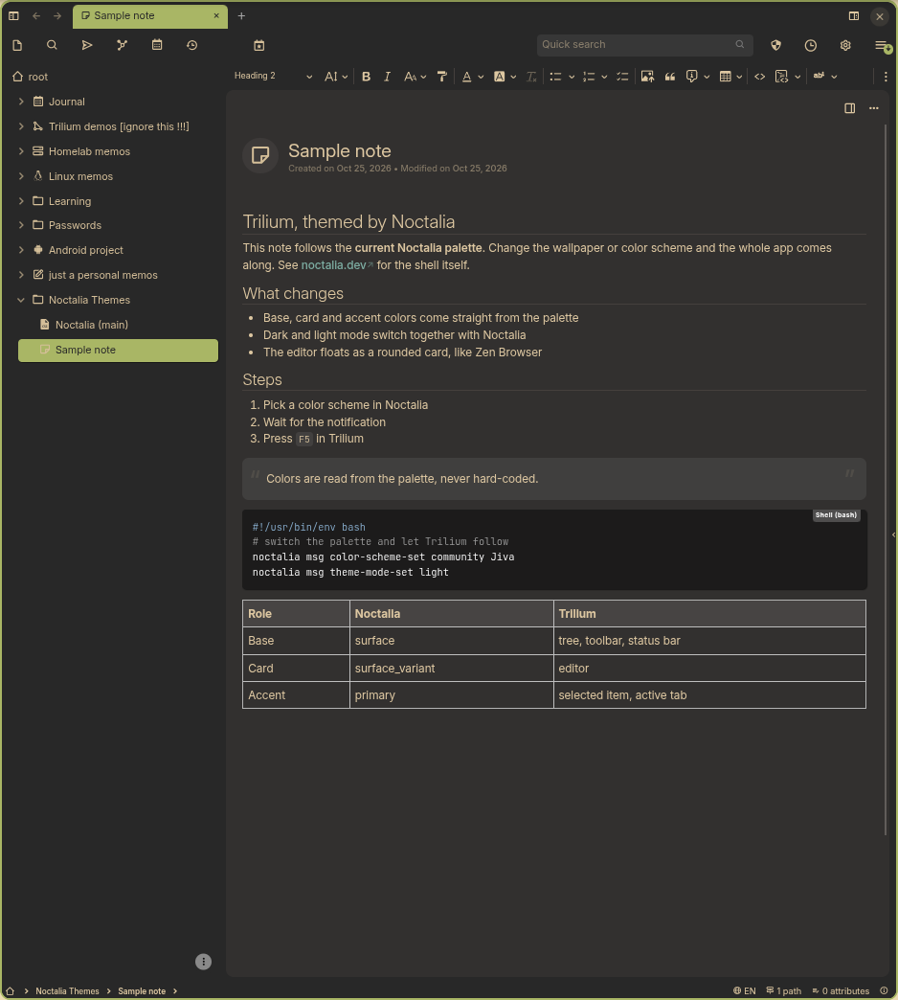
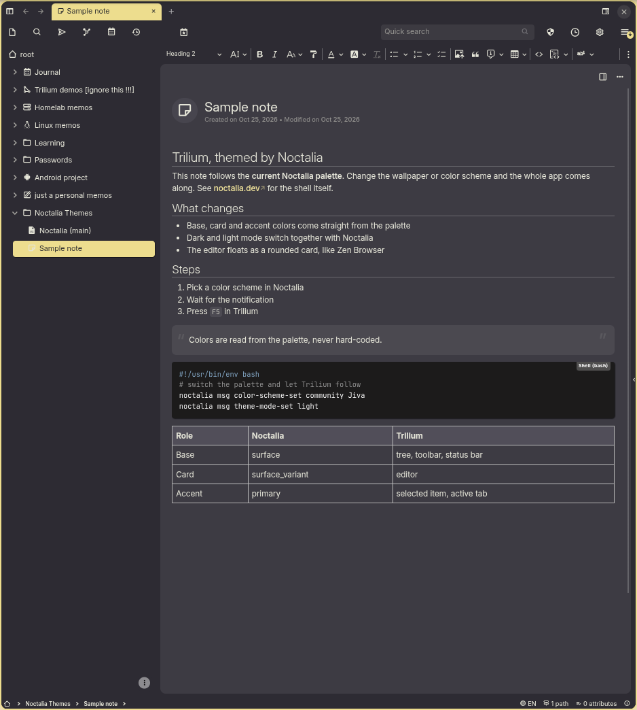
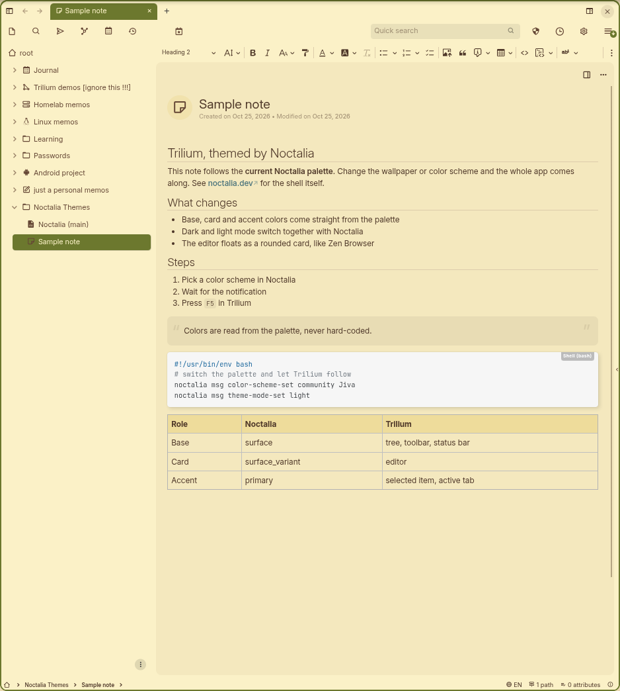
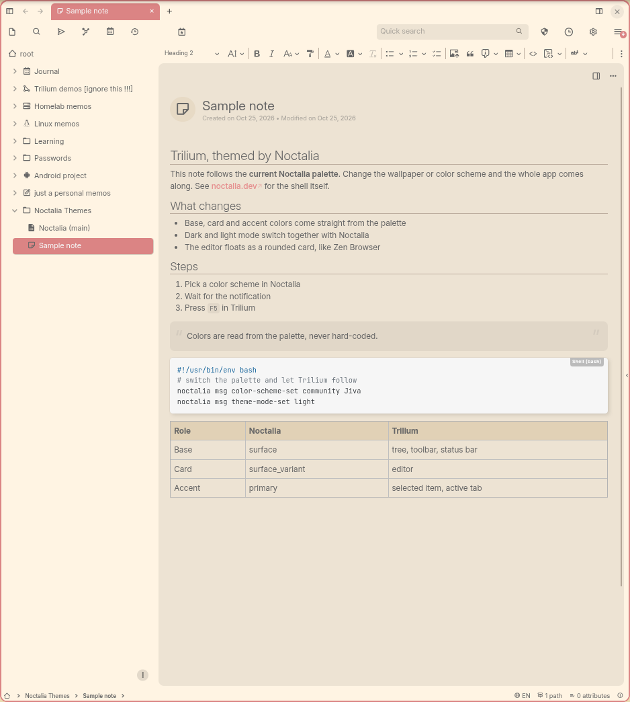

# Noctalia theme for Trilium

Make the [Trilium Notes](https://github.com/TriliumNext/Trilium) desktop app follow your
[Noctalia](https://noctalia.dev) color scheme. Change the wallpaper, the palette or dark/light mode in
Noctalia, and Trilium comes along.

Target: Noctalia v5 (tested on 5.3.0) / Trilium desktop 0.106 (Next theme)

Each machine gets its own theme note, so every machine keeps its own colors even though they all sync
with the same Trilium server.

## Screenshots

Gruvbox Material Medium and Jiva, dark and light. Same note, same layout, only the Noctalia palette changed.

<p>
  
  
</p>
<p>
  
  
</p>

## How it works

1. A Noctalia **user template** (`templates/trilium.css`) renders a CSS file from the current palette.
2. Its **post_hook** (`bin/push.sh`) writes that CSS into this machine's theme note through Trilium's
   **ETAPI** (the desktop app's local REST API).
3. You pick that theme once in Trilium (Options -> Appearance).

A Trilium theme is a note in the database, not a file, which is why step 2 exists.

The CSS has two layers:

| File | Layer | What it does |
|---|---|---|
| `templates/trilium.css` | colors | Overrides Next theme variables only. Rendered by Noctalia. |
| `templates/trilium-layout.css` | layout | Turns the editor into a floating rounded card (Zen Browser style). No colors of its own. |

`push.sh` pushes "colors, then layout" as one note. The color mapping is explained in
[docs/MAPPING.md](docs/MAPPING.md).

## Requirements

- Trilium desktop app (`triliumnext` from the AUR, or the official `.deb` from the Trilium releases)
- Noctalia v5
- `python3`, `curl`, `notify-send`, `wl-paste` (wl-clipboard)

## Install

1. Clone this repository anywhere.
2. In **this machine's** Trilium desktop app: Options -> ETAPI -> "Create new ETAPI token". Copy the token,
   then put it in place straight from the clipboard:

   ```sh
   (umask 077; mkdir -p ~/.config/noctalia/trilium; wl-paste -n > ~/.config/noctalia/trilium/etapi-token)
   ```

   ETAPI tokens are not synced, so create one per machine. Revoking one machine's token leaves the others alone.
3. With Trilium running, give the machine a name (lowercase letters, digits, hyphens) and run:

   ```sh
   ./install.sh laptop
   ```

   This creates a "Noctalia Themes" note and a "Noctalia (laptop)" theme note under it, registers the
   Noctalia template and pushes the current colors. Later runs are just `./install.sh`; it is safe to
   run any number of times.
4. In Trilium: Options -> Appearance -> pick **Noctalia (laptop)**. Only once; the theme choice is per machine.

## Daily use

- **Change the palette or mode in Noctalia** -> a "Trilium theme updated" notification shows up ->
  press **F5** (or Ctrl+R) in Trilium. An open window only picks up new CSS after a reload.
  (In Trilium 0.106 the reload shortcut is F5 / Ctrl+R, not Ctrl+Shift+R.)
- **Changed it while Trilium was closed?** `install.sh` puts a launcher entry in
  `~/.local/share/applications/`, named after the system entry (`triliumnext.desktop` from the AUR or
  `trilium.desktop` from the official `.deb`, searched in that order). Launching Trilium from your launcher
  pushes the latest colors once it is up, so you get the notification after the window appears -> F5.
- Nothing changed -> nothing is pushed and no notification.

## Editing the CSS

Edit anything under `templates/`, then run `./install.sh` -> F5. Same on every machine after pulling.

If the color CSS is not re-rendered, run `noctalia msg templates-apply` (re-renders every app's template)
and `./install.sh` again.

### Turning the layout layer off

If a Trilium update breaks the layout, add this line to `~/.config/noctalia/trilium/machine.conf` and run
`./install.sh` -> F5:

```
LAYOUT=off
```

You keep the colors on a plain two-pane layout. This is per machine.

## What gets installed

| Where | What |
|---|---|
| `~/.config/noctalia/trilium/` | `machine.conf`, `host.conf`, `etapi-token`, `bin/`, `template.css`, `layout.css`, `generated.css` |
| `~/.config/noctalia/trilium.toml` | the Noctalia user template |
| `~/.local/share/applications/triliumnext.desktop` or `trilium.desktop` | launcher entry (same name as the system entry); reads the system entry's Exec line on every launch |
| `hosts/<name>.conf` (this folder, git-ignored) | ETAPI URL and theme note ID (never the token) |
| Trilium | "Noctalia Themes" at the root, with "Noctalia (<name>)" under it |

## Uninstall

```sh
rm ~/.config/noctalia/trilium.toml
rm -f ~/.local/share/applications/triliumnext.desktop ~/.local/share/applications/trilium.desktop
rm -r ~/.config/noctalia/trilium
```

Then in Trilium: switch Options -> Appearance back to another theme, delete the token in Options -> ETAPI,
and delete the "Noctalia (<name>)" note (and "Noctalia Themes" if no other machine uses it).

## Notes

- Uses the desktop app's own ETAPI at `127.0.0.1:37840`, so it works offline and does not need the sync
  server. If your desktop app listens on another port, put `ETAPI_URL=http://127.0.0.1:<port>/etapi` in
  `hosts/<name>.conf` before running `install.sh`.
- Syntax highlighting is not themed. Code notes and code blocks use Trilium's own code themes
  (Options -> Appearance).
- Built and tested on Artix Linux with MangoWM. Other Wayland compositors should work as long as
  Noctalia does.

## License

MIT
